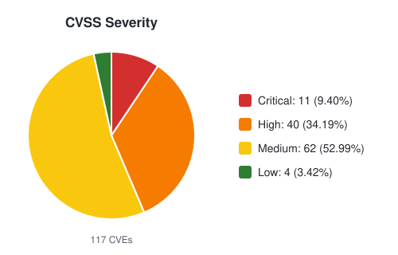
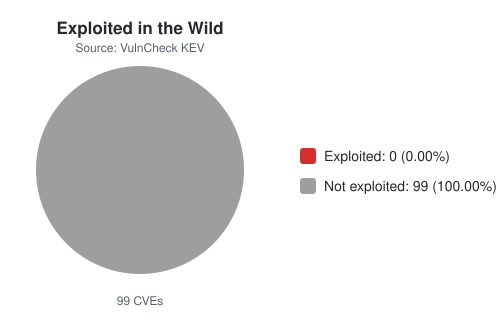

# OPENAI CVE TRACKER

## Overview
Tracking vulnerabilities that credit OpenAI researchers, including OpenAI Security Research, Codex Security, and work done in collaboration with OpenAI.

**CURRENT CVE COUNT: 161**

## Distributions

<table>
  <tr>
    <td>
      <picture>
        <source media="(prefers-color-scheme: dark)" srcset="assets/cvss-severity-dark.svg">
        
      </picture>
    </td>
    <td>
      <picture>
        <source media="(prefers-color-scheme: dark)" srcset="assets/kev-exploited-dark.svg">
        
      </picture>
    </td>
  </tr>
</table>

## Add a Vulnerability
If you find an OpenAI credited vulnerability, please open a Pull Request.

## Considerations

This project is maintained on a best effort basis.

## The List

<!-- BEGIN_CVE_TABLE -->
| CVE | Date | Vendor | Product | CVSS | KEV | Credit |
| --- | --- | --- | --- | --- | --- | --- |
| [CVE-2026-96453](https://www.cve.org/CVERecord?id=CVE-2026-96453) | 2026-11-05 | Red Hat | Red Hat AMQ Broker 7 | 8.0 |  | Red Hat would like to thank Paul Bottinelli (Trail of Bits in collaboration with OpenAI) for reporting this issue. |
| [CVE-2026-112375](https://www.cve.org/CVERecord?id=CVE-2026-112375) | 2026-10-28 | Apache Software Foundation | Apache Kafka | 6.5 |  | Arthur Chan <arthur.chan@adalogics.com>, Ada Logics and Anthropic Research \| OpenAI Codex Security - Amy Burnett and Khai Tran \| Mickael Maison <mickael.maison@gmail.com> \| Manikumar Reddy <manikumar.reddy@gmail.com> \| Chia-Ping Tsai <chia7712@gmail.com> |
| [CVE-2026-118017](https://www.cve.org/CVERecord?id=CVE-2026-118017) | 2026-10-27 | Mozilla | Firefox | 8.8 |  | OpenAI Codex Security (kylebot) |
| [CVE-2026-118016](https://www.cve.org/CVERecord?id=CVE-2026-118016) | 2026-10-27 | Mozilla | Firefox | 8.8 |  | OpenAI Codex Security (kylebot) |
| [CVE-2026-118015](https://www.cve.org/CVERecord?id=CVE-2026-118015) | 2026-10-27 | Mozilla | Firefox | 8.8 |  | OpenAI Codex Security (kylebot) |
| [CVE-2026-118014](https://www.cve.org/CVERecord?id=CVE-2026-118014) | 2026-10-27 | Mozilla | Firefox | 8.8 |  | OpenAI Codex Security (kylebot) |
| [CVE-2026-118013](https://www.cve.org/CVERecord?id=CVE-2026-118013) | 2026-10-27 | Mozilla | Firefox | 8.8 |  | OpenAI Codex Security (kylebot) |
| [CVE-2026-118012](https://www.cve.org/CVERecord?id=CVE-2026-118012) | 2026-10-27 | Mozilla | Firefox | 8.8 |  | OpenAI Codex Security (kylebot) |
| [CVE-2026-118011](https://www.cve.org/CVERecord?id=CVE-2026-118011) | 2026-10-27 | Mozilla | Firefox | 8.8 |  | OpenAI Codex Security (kylebot) |
| [CVE-2026-118008](https://www.cve.org/CVERecord?id=CVE-2026-118008) | 2026-10-27 | Mozilla | Firefox | 8.8 |  | Amy Burnett of OpenAI |
| [CVE-2026-117954](https://www.cve.org/CVERecord?id=CVE-2026-117954) | 2026-10-27 | Mozilla | Firefox | 8.8 |  | OpenAI Codex Security (kylebot) |
| [CVE-2026-117953](https://www.cve.org/CVERecord?id=CVE-2026-117953) | 2026-10-27 | Mozilla | Firefox | 8.8 |  | OpenAI Codex Security (kylebot) |
| [CVE-2026-117952](https://www.cve.org/CVERecord?id=CVE-2026-117952) | 2026-10-27 | Mozilla | Firefox | 8.1 |  | OpenAI Codex Security (kylebot) |
| [CVE-2026-117951](https://www.cve.org/CVERecord?id=CVE-2026-117951) | 2026-10-27 | Mozilla | Firefox | 8.8 |  | OpenAI Codex Security (kylebot) |
| [CVE-2026-117950](https://www.cve.org/CVERecord?id=CVE-2026-117950) | 2026-10-27 | Mozilla | Firefox | 8.8 |  | OpenAI Codex Security (kylebot) |
| [CVE-2026-117949](https://www.cve.org/CVERecord?id=CVE-2026-117949) | 2026-10-27 | Mozilla | Firefox | 8.8 |  | OpenAI Codex Security (kylebot) |
| [CVE-2026-117948](https://www.cve.org/CVERecord?id=CVE-2026-117948) | 2026-10-27 | Mozilla | Firefox | 6.3 |  | OpenAI Codex Security (kylebot) |
| [CVE-2026-117947](https://www.cve.org/CVERecord?id=CVE-2026-117947) | 2026-10-27 | Mozilla | Firefox | 6.3 |  | OpenAI Codex Security (kylebot) |
| [CVE-2026-117946](https://www.cve.org/CVERecord?id=CVE-2026-117946) | 2026-10-27 | Mozilla | Firefox | 9.8 |  | OpenAI Codex Security (kylebot) |
| [CVE-2026-117945](https://www.cve.org/CVERecord?id=CVE-2026-117945) | 2026-10-27 | Mozilla | Firefox | 9.8 |  | OpenAI Codex Security (kylebot) |
| [CVE-2026-117944](https://www.cve.org/CVERecord?id=CVE-2026-117944) | 2026-10-27 | Mozilla | Firefox | 6.3 |  | OpenAI Codex Security (kylebot) |
| [CVE-2026-117943](https://www.cve.org/CVERecord?id=CVE-2026-117943) | 2026-10-27 | Mozilla | Firefox | 8.8 |  | OpenAI Codex Security (kylebot) |
| [CVE-2026-117942](https://www.cve.org/CVERecord?id=CVE-2026-117942) | 2026-10-27 | Mozilla | Firefox | 7.3 |  | OpenAI Codex Security (kylebot) |
| [CVE-2026-117941](https://www.cve.org/CVERecord?id=CVE-2026-117941) | 2026-10-27 | Mozilla | Firefox | 8.8 |  | OpenAI Codex Security (kylebot) |
| [CVE-2026-117940](https://www.cve.org/CVERecord?id=CVE-2026-117940) | 2026-10-27 | Mozilla | Firefox | 8.8 |  | OpenAI Codex Security (kylebot) |
| [CVE-2026-117939](https://www.cve.org/CVERecord?id=CVE-2026-117939) | 2026-10-27 | Mozilla | Firefox | 6.3 |  | OpenAI Codex Security (kylebot) |
| [CVE-2026-117938](https://www.cve.org/CVERecord?id=CVE-2026-117938) | 2026-10-27 | Mozilla | Firefox | 6.3 |  | OpenAI Codex Security (kylebot) |
| [CVE-2026-117937](https://www.cve.org/CVERecord?id=CVE-2026-117937) | 2026-10-27 | Mozilla | Firefox | 7.3 |  | OpenAI Codex Security (kylebot) |
| [CVE-2026-117936](https://www.cve.org/CVERecord?id=CVE-2026-117936) | 2026-10-27 | Mozilla | Firefox | 8.8 |  | OpenAI Codex Security (kylebot) |
| [CVE-2026-117935](https://www.cve.org/CVERecord?id=CVE-2026-117935) | 2026-10-27 | Mozilla | Firefox | 6.3 |  | OpenAI Codex Security (kylebot) |
| [CVE-2026-117934](https://www.cve.org/CVERecord?id=CVE-2026-117934) | 2026-10-27 | Mozilla | Firefox | 6.3 |  | OpenAI Codex Security (kylebot) |
| [CVE-2026-117933](https://www.cve.org/CVERecord?id=CVE-2026-117933) | 2026-10-27 | Mozilla | Firefox | 5.4 |  | OpenAI Codex Security (kylebot) |
| [CVE-2026-117932](https://www.cve.org/CVERecord?id=CVE-2026-117932) | 2026-10-27 | Mozilla | Firefox | 8.8 |  | OpenAI Codex Security (kylebot) |
| [CVE-2026-117931](https://www.cve.org/CVERecord?id=CVE-2026-117931) | 2026-10-27 | Mozilla | Firefox | 8.8 |  | OpenAI Codex Security (kylebot) |
| [CVE-2026-117930](https://www.cve.org/CVERecord?id=CVE-2026-117930) | 2026-10-27 | Mozilla | Firefox | 8.8 |  | OpenAI Codex Security (kylebot) |
| [CVE-2026-117922](https://www.cve.org/CVERecord?id=CVE-2026-117922) | 2026-10-27 | Mozilla | Firefox | 8.8 |  | OpenAI Codex Security (kylebot) |
| [CVE-2026-117921](https://www.cve.org/CVERecord?id=CVE-2026-117921) | 2026-10-27 | Mozilla | Firefox | 8.8 |  | OpenAI Codex Security (kylebot) |
| [CVE-2026-117883](https://www.cve.org/CVERecord?id=CVE-2026-117883) | 2026-10-27 | Mozilla | Firefox | 8.8 |  | Amy Burnett of OpenAI |
| [CVE-2026-117882](https://www.cve.org/CVERecord?id=CVE-2026-117882) | 2026-10-27 | Mozilla | Firefox | 6.3 |  | Amy Burnett of OpenAI |
| [CVE-2026-117881](https://www.cve.org/CVERecord?id=CVE-2026-117881) | 2026-10-27 | Mozilla | Firefox | 8.8 |  | Amy Burnett of OpenAI |
| [CVE-2026-117879](https://www.cve.org/CVERecord?id=CVE-2026-117879) | 2026-10-27 | Mozilla | Firefox | 7.3 |  | Amy Burnett of OpenAI |
| [CVE-2026-117878](https://www.cve.org/CVERecord?id=CVE-2026-117878) | 2026-10-27 | Mozilla | Firefox | 6.3 |  | Amy Burnett of OpenAI |
| [CVE-2026-117876](https://www.cve.org/CVERecord?id=CVE-2026-117876) | 2026-10-27 | Mozilla | Firefox | 6.3 |  | Amy Burnett of OpenAI |
| [CVE-2026-111497](https://www.cve.org/CVERecord?id=CVE-2026-111497) | 2026-10-22 | Google | Brotli | 9.2 | ✅ | OpenAI Codex Security - Khai Tran and Sylvie Mayer |
| [CVE-2026-109619](https://www.cve.org/CVERecord?id=CVE-2026-109619) | 2026-10-21 | PHP Group | PHP | 9.2 | ✅ | Wiz \| Ryan at Calif.io \| OpenAI \| Arnaud Le Blanc \| Ilija Tovilo \| Jakub Zelenka \| Nora Dossche |
| [CVE-2026-109618](https://www.cve.org/CVERecord?id=CVE-2026-109618) | 2026-10-21 | PHP Group | PHP | 9.2 | ✅ | Ryan at Calif.io \| Wiz \| OpenAI \| Arnaud Le Blanc \| Ilija Tovilo \| Jakub Zelenka \| Nora Dossche |
| [CVE-2026-94300](https://www.cve.org/CVERecord?id=CVE-2026-94300) | 2026-10-21 | ISC | BIND 9 | 8.1 |  | While this flaw was discovered in internal testing, ISC would like to thank Dave Aitel from OpenAI who independently discovered and responsibly reported the issue to ISC. |
| [CVE-2026-107350](https://www.cve.org/CVERecord?id=CVE-2026-107350) | 2026-10-14 | n/a | PgBouncer | 8.8 |  | Thanks to Dave Aitel (@daveaitel-openai, OpenAI) for finding and reporting this issue. |
| [CVE-2026-109733](https://www.cve.org/CVERecord?id=CVE-2026-109733) | 2026-10-13 | Mozilla | Firefox | 8.1 |  | Amy Burnett of OpenAI |
| [CVE-2026-109731](https://www.cve.org/CVERecord?id=CVE-2026-109731) | 2026-10-13 | Mozilla | Firefox | 5.4 |  | Amy Burnett of OpenAI |
| [CVE-2026-109728](https://www.cve.org/CVERecord?id=CVE-2026-109728) | 2026-10-13 | Mozilla | Firefox | 5.4 |  | Amy Burnett of OpenAI |
| [CVE-2026-109723](https://www.cve.org/CVERecord?id=CVE-2026-109723) | 2026-10-13 | Mozilla | Firefox | 5.4 |  | Amy Burnett of OpenAI |
| [CVE-2026-109722](https://www.cve.org/CVERecord?id=CVE-2026-109722) | 2026-10-13 | Mozilla | Firefox | 8.1 |  | Amy Burnett of OpenAI |
| [CVE-2026-109721](https://www.cve.org/CVERecord?id=CVE-2026-109721) | 2026-10-13 | Mozilla | Firefox | 5.4 |  | Amy Burnett of OpenAI |
| [CVE-2026-109720](https://www.cve.org/CVERecord?id=CVE-2026-109720) | 2026-10-13 | Mozilla | Firefox | 7.1 |  | Amy Burnett of OpenAI |
| [CVE-2026-109716](https://www.cve.org/CVERecord?id=CVE-2026-109716) | 2026-10-13 | Mozilla | Firefox | 8.1 |  | Amy Burnett of OpenAI |
| [CVE-2026-109715](https://www.cve.org/CVERecord?id=CVE-2026-109715) | 2026-10-13 | Mozilla | Firefox | 8.1 |  | Amy Burnett of OpenAI |
| [CVE-2026-95702](https://www.cve.org/CVERecord?id=CVE-2026-95702) | 2026-10-09 | Google | gVisor | 8.5 |  | Mikhail Sosonkin from OpenAI |
| [CVE-2026-107121](https://www.cve.org/CVERecord?id=CVE-2026-107121) | 2026-10-07 | Red Hat | Red Hat Build of Keycloak | 6.5 |  | Red Hat would like to thank Paul Bottinelli of Trail of Bits in collaboration with OpenAI for reporting this issue. |
| [CVE-2026-77185](https://www.cve.org/CVERecord?id=CVE-2026-77185) | 2026-09-30 | Apache Software Foundation | Apache MINA SSHD | 9.1 |  | Chris Jarret-Davies, OpenAI Security Research Team |
| [CVE-2026-100793](https://www.cve.org/CVERecord?id=CVE-2026-100793) | 2026-09-29 | Mozilla | Thunderbird | 6.5 |  | Amy Burnett of OpenAI |
| [CVE-2026-100792](https://www.cve.org/CVERecord?id=CVE-2026-100792) | 2026-09-29 | Mozilla | Thunderbird | 7.1 |  | Amy Burnett of OpenAI |
| [CVE-2026-97177](https://www.cve.org/CVERecord?id=CVE-2026-97177) | 2026-09-24 | Red Hat | Red Hat Build of Keycloak | 6.6 |  | Red Hat would like to thank Paul Bottinelli of Trail of Bits in collaboration with OpenAI for reporting this issue. |
| [CVE-2026-96445](https://www.cve.org/CVERecord?id=CVE-2026-96445) | 2026-09-23 | Red Hat | Red Hat Build of Keycloak | 6.8 |  | Red Hat would like to thank Paul Bottinelli (Trail of Bits in collaboration with OpenAI) for reporting this issue. |
| [CVE-2026-94001](https://www.cve.org/CVERecord?id=CVE-2026-94001) | 2026-09-19 | Red Hat | Red Hat Build of Keycloak | 6.5 |  | Red Hat would like to thank Paul Bottinelli of Trail of Bits in collaboration with OpenAI for reporting this issue. |
| [CVE-2026-90997](https://www.cve.org/CVERecord?id=CVE-2026-90997) | 2026-09-17 | Keycloak | Keycloak | 7.4 |  | Red Hat would like to thank Bruno Oliveira of IBM in collaboration with OpenAI for reporting this issue. |
| [CVE-2026-18212](https://www.cve.org/CVERecord?id=CVE-2026-18212) | 2026-09-16 | Red Hat | Red Hat build of Keycloak 26.4 | 7.5 |  | Red Hat would like to thank Paul Bottinelli (Trail of Bits in collaboration with OpenAI) for reporting this issue. |
| [CVE-2026-92054](https://www.cve.org/CVERecord?id=CVE-2026-92054) | 2026-09-15 | Mozilla | Firefox | 8.8 |  | Amy Burnett of OpenAI |
| [CVE-2026-18922](https://www.cve.org/CVERecord?id=CVE-2026-18922) | 2026-09-07 | Red Hat | Red Hat Directory Server 11.7 E4S for RHEL 8 | 9.8 |  | Red Hat would like to thank Chris Jarrett-Davies (OpenAI Security Research) for reporting this issue. |
| [CVE-2026-70551](https://www.cve.org/CVERecord?id=CVE-2026-70551) | 2026-08-25 | jfrog | artifactory | 8.5 |  | Kostya Kortchinsky \| OpenAI |
| [CVE-2026-70550](https://www.cve.org/CVERecord?id=CVE-2026-70550) | 2026-08-25 | jfrog | artifactory | 6.5 |  | Khai Tran \| OpenAI |
| [CVE-2026-70548](https://www.cve.org/CVERecord?id=CVE-2026-70548) | 2026-08-25 | jfrog | artifactory | 3.5 |  | Kostya Kortchinsky \| OpenAI |
| [CVE-2026-69104](https://www.cve.org/CVERecord?id=CVE-2026-69104) | 2026-08-25 | jfrog | artifactory | 7.6 |  | Kostya Kortchinsky \| OpenAI |
| [CVE-2026-74630](https://www.cve.org/CVERecord?id=CVE-2026-74630) | 2026-08-22 | Linux | Linux | 7.8 |  | Bug found and triaged by OpenAI Security Research and validated by Trail of Bits |
| [CVE-2026-49428](https://www.cve.org/CVERecord?id=CVE-2026-49428) | 2026-08-19 | FreeBSD | FreeBSD | 8.4 |  | Chris Jarrett-Davies of the OpenAI Codex Security Team |
| [CVE-2026-49427](https://www.cve.org/CVERecord?id=CVE-2026-49427) | 2026-08-19 | FreeBSD | FreeBSD | 8.8 |  | Chris Jarrett-Davies of the OpenAI Codex Security Team |
| [CVE-2026-74984](https://www.cve.org/CVERecord?id=CVE-2026-74984) | 2026-08-18 | Mozilla | Firefox | 6.8 |  | Amy Burnett of OpenAI |
| [CVE-2026-74944](https://www.cve.org/CVERecord?id=CVE-2026-74944) | 2026-08-18 | Mozilla | Firefox | 9.8 |  | Amy Burnett of OpenAI |
| [CVE-2026-74938](https://www.cve.org/CVERecord?id=CVE-2026-74938) | 2026-08-18 | Mozilla | Firefox | 9.1 |  | Amy Burnett of OpenAI |
| [CVE-2026-74937](https://www.cve.org/CVERecord?id=CVE-2026-74937) | 2026-08-18 | Mozilla | Firefox | 8.8 |  | Amy Burnett of OpenAI |
| [CVE-2026-74936](https://www.cve.org/CVERecord?id=CVE-2026-74936) | 2026-08-18 | Mozilla | Firefox | 9.8 |  | Amy Burnett of OpenAI |
| [CVE-2026-19608](https://www.cve.org/CVERecord?id=CVE-2026-19608) | 2026-08-18 | Red Hat | Red Hat Build of Keycloak | 5.3 |  | Red Hat would like to thank Paul Bottinelli of Trail of Bits in collaboration with OpenAI for reporting this issue. |
| [CVE-2026-16238](https://www.cve.org/CVERecord?id=CVE-2026-16238) | 2026-08-13 | n/a | PostgreSQL | 8.8 |  | The PostgreSQL project thanks Amy Burnett (OpenAI Codex Security) for reporting this problem. |
| [CVE-2026-14680](https://www.cve.org/CVERecord?id=CVE-2026-14680) | 2026-08-13 | n/a | PostgreSQL | 8.8 |  | The PostgreSQL project thanks Amy Burnett (OpenAI Codex Security) for reporting this problem. |
| [CVE-2026-14669](https://www.cve.org/CVERecord?id=CVE-2026-14669) | 2026-08-13 | n/a | PostgreSQL | 8.8 |  | The PostgreSQL project thanks Hcamael, Amjad Shahzad, Tomer Fichman, Zheng Yu, Amy Burnett (OpenAI Codex Security), Rick de Jager, Heewon Song, Sylvie Mayer, Aleksander Alekseev, and Hillai Ben Sasson for reporting this problem. |
| [CVE-2026-73432](https://www.cve.org/CVERecord?id=CVE-2026-73432) | 2026-08-12 | vulnerability-lookup | vulnerability-lookup | 5.1 |  | openai/gpt-5.5-cyber-preview (reasoning level: high) \| EUVD @ ENISA Team \| Cedric Bonhomme \| Alexandre Dulaunoy |
| [CVE-2026-73431](https://www.cve.org/CVERecord?id=CVE-2026-73431) | 2026-08-12 | vulnerability-lookup | vulnerability-lookup | 8.8 |  | openai/gpt-5.5-cyber-preview (reasoning level: high) \| EUVD @ ENISA Team \| Cedric Bonhomme \| Alexandre Dulaunoy |
| [CVE-2026-73405](https://www.cve.org/CVERecord?id=CVE-2026-73405) | 2026-08-12 | vulnerability-lookup | vulnerability-lookup | 5.3 |  | openai/gpt-5.5-cyber-preview (reasoning level: high) \| EUVD @ ENISA Team \| Cedric Bonhomme \| Alexandre Dulaunoy |
| [CVE-2026-73374](https://www.cve.org/CVERecord?id=CVE-2026-73374) | 2026-08-12 | vulnerability-lookup | vulnerability-lookup | 6.1 |  | openai/gpt-5.5-cyber-preview (reasoning level: high) \| EUVD @ ENISA Team \| Cedric Bonhomme \| Alexandre Dulaunoy |
| [CVE-2026-70547](https://www.cve.org/CVERecord?id=CVE-2026-70547) | 2026-08-12 | jfrog | artifactory | 4.3 |  | Kostya Kortchinsky \| OpenAI |
| [CVE-2026-69105](https://www.cve.org/CVERecord?id=CVE-2026-69105) | 2026-08-12 | jfrog | artifactory | 8.1 |  | Kostya Kortchinsky \| OpenAI |
| [CVE-2026-68759](https://www.cve.org/CVERecord?id=CVE-2026-68759) | 2026-08-12 | jfrog | artifactory | 7.2 |  | OpenAI |
| [CVE-2026-68758](https://www.cve.org/CVERecord?id=CVE-2026-68758) | 2026-08-12 | jfrog | artifactory | 6.5 |  | Khai Tran \| OpenAI |
| [CVE-2026-68755](https://www.cve.org/CVERecord?id=CVE-2026-68755) | 2026-08-12 | jfrog | artifactory | 4.3 |  | Khai Tran \| OpenAI |
| [CVE-2026-68754](https://www.cve.org/CVERecord?id=CVE-2026-68754) | 2026-08-12 | jfrog | artifactory | 6.5 |  | Khai Tran \| OpenAI |
| [CVE-2026-68753](https://www.cve.org/CVERecord?id=CVE-2026-68753) | 2026-08-12 | jfrog | artifactory | 5.3 |  | Khai Tran \| OpenAI |
| [CVE-2026-68752](https://www.cve.org/CVERecord?id=CVE-2026-68752) | 2026-08-12 | jfrog | artifactory | 7.2 |  | OpenAI |
| [CVE-2026-66384](https://www.cve.org/CVERecord?id=CVE-2026-66384) | 2026-08-12 | jfrog | artifactory | 5.3 | ✅ | Kostya Kortchinsky \| OpenAI |
| [CVE-2026-66382](https://www.cve.org/CVERecord?id=CVE-2026-66382) | 2026-08-12 | jfrog | artifactory | 4.3 |  | Khai Tran \| OpenAI |
| [CVE-2026-66381](https://www.cve.org/CVERecord?id=CVE-2026-66381) | 2026-08-12 | jfrog | artifactory | 5.3 |  | Khai Tran \| OpenAI |
| [CVE-2026-66380](https://www.cve.org/CVERecord?id=CVE-2026-66380) | 2026-08-12 | jfrog | artifactory | 4.3 |  | Khai Tran \| OpenAI |
| [CVE-2026-66379](https://www.cve.org/CVERecord?id=CVE-2026-66379) | 2026-08-12 | jfrog | artifactory | 4.3 |  | Khai Tran \| OpenAI |
| [CVE-2026-66378](https://www.cve.org/CVERecord?id=CVE-2026-66378) | 2026-08-12 | jfrog | artifactory | 4.3 |  | Khai Tran \| OpenAI |
| [CVE-2026-66377](https://www.cve.org/CVERecord?id=CVE-2026-66377) | 2026-08-12 | jfrog | artifactory | 5.3 |  | Khai Tran \| OpenAI |
| [CVE-2026-66375](https://www.cve.org/CVERecord?id=CVE-2026-66375) | 2026-08-12 | jfrog | artifactory | 8.1 |  | Khai Tran \| OpenAI |
| [CVE-2026-66016](https://www.cve.org/CVERecord?id=CVE-2026-66016) | 2026-08-12 | jfrog | artifactory | 6.7 |  | Matthew Bryant \| OpenAI |
| [CVE-2026-65926](https://www.cve.org/CVERecord?id=CVE-2026-65926) | 2026-08-12 | jfrog | artifactory | 3.1 |  | Khai Tran \| OpenAI |
| [CVE-2026-16443](https://www.cve.org/CVERecord?id=CVE-2026-16443) | 2026-08-05 | Red Hat | Red Hat build of Keycloak 26.4 | 7.4 |  | Red Hat would like to thank Paul Bottinelli (Trail of Bits in collaboration with OpenAI) for reporting this issue. |
| [CVE-2026-16442](https://www.cve.org/CVERecord?id=CVE-2026-16442) | 2026-08-05 | Red Hat | Red Hat build of Keycloak 26.4 | 7.4 |  | Red Hat would like to thank Paul Bottinelli (Trail of Bits in collaboration with OpenAI) for reporting this issue. |
| [CVE-2026-16100](https://www.cve.org/CVERecord?id=CVE-2026-16100) | 2026-08-05 | Red Hat | Red Hat build of Keycloak 26.6 | 6.5 |  | Red Hat would like to thank Paul Bottinelli (Trail of Bits in collaboration with OpenAI) for reporting this issue. |
| [CVE-2026-16071](https://www.cve.org/CVERecord?id=CVE-2026-16071) | 2026-08-05 | Red Hat | Red Hat build of Keycloak 26.4 | 5.4 |  | Red Hat would like to thank Paul Bottinelli (Trail of Bits in collaboration with OpenAI) for reporting this issue. |
| [CVE-2026-18569](https://www.cve.org/CVERecord?id=CVE-2026-18569) | 2026-08-04 | Red Hat | Red Hat Build of Keycloak | 3.7 |  | Red Hat would like to thank Paul Bottinelli (Trail of Bits in collaboration with OpenAI) for reporting this issue. |
| [CVE-2026-18651](https://www.cve.org/CVERecord?id=CVE-2026-18651) | 2026-08-03 | Red Hat | Red Hat Directory Server 11 | 5.4 |  | Red Hat would like to thank Andrew Rukin (Arenadata) and Chris Jarrett-Davies (OpenAI Security Research) for reporting this issue. |
| [CVE-2026-18573](https://www.cve.org/CVERecord?id=CVE-2026-18573) | 2026-08-02 | Red Hat | Red Hat build of Keycloak 26.6 | 6.5 |  | Red Hat would like to thank Paul Bottinelli (Trail of Bits in collaboration with OpenAI) for reporting this issue. |
| [CVE-2026-18572](https://www.cve.org/CVERecord?id=CVE-2026-18572) | 2026-08-02 | Red Hat | Red Hat build of Keycloak 26.6 | 6.5 |  | Red Hat would like to thank Paul Bottinelli (Trail of Bits in collaboration with OpenAI) for reporting this issue. |
| [CVE-2026-18570](https://www.cve.org/CVERecord?id=CVE-2026-18570) | 2026-08-02 | Red Hat | Red Hat build of Keycloak 26.6 | 5.4 |  | Red Hat would like to thank Paul Bottinelli (Trail of Bits in collaboration with OpenAI) for reporting this issue. |
| [CVE-2026-18218](https://www.cve.org/CVERecord?id=CVE-2026-18218) | 2026-07-31 | Red Hat | Red Hat build of Keycloak 26.6 | 4.2 |  | Red Hat would like to thank Paul Bottinelli (Trail of Bits in collaboration with OpenAI) for reporting this issue. |
| [CVE-2026-18215](https://www.cve.org/CVERecord?id=CVE-2026-18215) | 2026-07-31 | Red Hat | Red Hat build of Keycloak 26.6 | 6.8 |  | Red Hat would like to thank Paul Bottinelli (Trail of Bits in collaboration with OpenAI) for reporting this issue. |
| [CVE-2026-18214](https://www.cve.org/CVERecord?id=CVE-2026-18214) | 2026-07-31 | Red Hat | Red Hat build of Keycloak 26.6 | 6.8 |  | Red Hat would like to thank Paul Bottinelli (Trail of Bits in collaboration with OpenAI) for reporting this issue. |
| [CVE-2026-18211](https://www.cve.org/CVERecord?id=CVE-2026-18211) | 2026-07-31 | Red Hat | Red Hat Build of Keycloak | 4.2 |  | Red Hat would like to thank Paul Bottinelli (Trail of Bits in collaboration with OpenAI) for reporting this issue. |
| [CVE-2026-18208](https://www.cve.org/CVERecord?id=CVE-2026-18208) | 2026-07-31 | Red Hat | Red Hat Build of Keycloak | 6.5 |  | Red Hat would like to thank Paul Bottinelli (Trail of Bits in collaboration with OpenAI) for reporting this issue. |
| [CVE-2026-18206](https://www.cve.org/CVERecord?id=CVE-2026-18206) | 2026-07-31 | Red Hat | Red Hat Build of Keycloak | 3.7 |  | Red Hat would like to thank Paul Bottinelli (Trail of Bits in collaboration with OpenAI) for reporting this issue. |
| [CVE-2026-18203](https://www.cve.org/CVERecord?id=CVE-2026-18203) | 2026-07-31 | Red Hat | Red Hat Build of Keycloak | 6.5 |  | Red Hat would like to thank Paul Bottinelli (Trail of Bits in collaboration with OpenAI) for reporting this issue. |
| [CVE-2026-58222](https://www.cve.org/CVERecord?id=CVE-2026-58222) | 2026-07-30 | Red Hat | Red Hat Enterprise Linux 10 | 8.8 |  | Red Hat would like to thank Andrew Tridgell (Samba Team), Bin Luo (University of Electronic Science and Technology of China (UESTC)), OpenAI Security Research, and Tristan Madani (Talence Security) for reporting this issue. |
| [CVE-2026-18207](https://www.cve.org/CVERecord?id=CVE-2026-18207) | 2026-07-29 | Red Hat | Red Hat Build of Keycloak | 6.5 |  | Red Hat would like to thank Paul Bottinelli (Trail of Bits in collaboration with OpenAI) for reporting this issue. |
| [CVE-2026-18201](https://www.cve.org/CVERecord?id=CVE-2026-18201) | 2026-07-29 | Red Hat | Red Hat build of Keycloak 26.6 | 5.5 |  | Red Hat would like to thank Paul Bottinelli (Trail of Bits in collaboration with OpenAI) for reporting this issue. |
| [CVE-2026-66018](https://www.cve.org/CVERecord?id=CVE-2026-66018) | 2026-07-27 | jfrog | artifactory | 6.5 |  | Khai Tran \| OpenAI |
| [CVE-2026-66015](https://www.cve.org/CVERecord?id=CVE-2026-66015) | 2026-07-27 | jfrog | artifactory | 7.2 |  | Amy Burnett \| OpenAI |
| [CVE-2026-66014](https://www.cve.org/CVERecord?id=CVE-2026-66014) | 2026-07-27 | jfrog | artifactory | 8.8 |  | Amy Burnett \| OpenAI |
| [CVE-2026-65925](https://www.cve.org/CVERecord?id=CVE-2026-65925) | 2026-07-27 | jfrog | artifactory | 6.5 |  | Matthew Bryant \| OpenAI |
| [CVE-2026-65924](https://www.cve.org/CVERecord?id=CVE-2026-65924) | 2026-07-27 | jfrog | artifactory | 6.5 |  | Amy Burnett \| OpenAI |
| [CVE-2026-65923](https://www.cve.org/CVERecord?id=CVE-2026-65923) | 2026-07-27 | jfrog | artifactory | 6.8 |  | Khai Tran \| OpenAI |
| [CVE-2026-65921](https://www.cve.org/CVERecord?id=CVE-2026-65921) | 2026-07-27 | jfrog | artifactory | 8.8 |  | Matthew Bryant \| OpenAI |
| [CVE-2026-65618](https://www.cve.org/CVERecord?id=CVE-2026-65618) | 2026-07-27 | jfrog | artifactory | 6.5 |  | Kostya Kortchinsky \| OpenAI |
| [CVE-2026-65617](https://www.cve.org/CVERecord?id=CVE-2026-65617) | 2026-07-27 | jfrog | artifactory | 8.8 |  | Kostya Kortchinsky \| OpenAI |
| [CVE-2026-65616](https://www.cve.org/CVERecord?id=CVE-2026-65616) | 2026-07-27 | jfrog | artifactory | 8.8 |  | Kostya Kortchinsky \| OpenAI |
| [CVE-2026-42017](https://www.cve.org/CVERecord?id=CVE-2026-42017) | 2026-07-27 | jfrog | artifactory | 8.8 |  | Kostya Kortchinsky \| OpenAI |
| [CVE-2026-42016](https://www.cve.org/CVERecord?id=CVE-2026-42016) | 2026-07-27 | jfrog | artifactory | 8.1 | ✅ | Kostya Kortchinsky \| OpenAI |
| [CVE-2026-16410](https://www.cve.org/CVERecord?id=CVE-2026-16410) | 2026-07-21 | Mozilla | Firefox | 9.8 |  | Amy Burnett of OpenAI |
| [CVE-2026-16409](https://www.cve.org/CVERecord?id=CVE-2026-16409) | 2026-07-21 | Mozilla | Firefox | 7.5 |  | Artur Cygan of Trail of Bits in partnership with OpenAI |
| [CVE-2026-16369](https://www.cve.org/CVERecord?id=CVE-2026-16369) | 2026-07-21 | Mozilla | Firefox | 9.8 |  | Amy Burnett of OpenAI |
| [CVE-2026-16355](https://www.cve.org/CVERecord?id=CVE-2026-16355) | 2026-07-21 | Mozilla | Firefox | 9.8 |  | Amy Burnett of OpenAI |
| [CVE-2026-16108](https://www.cve.org/CVERecord?id=CVE-2026-16108) | 2026-07-17 | Red Hat | Red Hat build of Keycloak 26.6 | 4.3 |  | Red Hat would like to thank Paul Bottinelli (Trail of Bits in collaboration with OpenAI) for reporting this issue. |
| [CVE-2026-16104](https://www.cve.org/CVERecord?id=CVE-2026-16104) | 2026-07-17 | Red Hat | Red Hat build of Keycloak 26.6 | 4.3 |  | Red Hat would like to thank Paul Bottinelli (Trail of Bits in collaboration with OpenAI) for reporting this issue. |
| [CVE-2026-16093](https://www.cve.org/CVERecord?id=CVE-2026-16093) | 2026-07-17 | Red Hat | Red Hat build of Keycloak 26.6 | 5.4 |  | Red Hat would like to thank Paul Bottinelli (Trail of Bits in collaboration with OpenAI) for reporting this issue. |
| [CVE-2026-16089](https://www.cve.org/CVERecord?id=CVE-2026-16089) | 2026-07-17 | Red Hat | Red Hat build of Keycloak 26.6 | 5.4 |  | Red Hat would like to thank Paul Bottinelli (Trail of Bits in collaboration with OpenAI) for reporting this issue. |
| [CVE-2026-16072](https://www.cve.org/CVERecord?id=CVE-2026-16072) | 2026-07-17 | Red Hat | Red Hat build of Keycloak 26.6 | 4.9 |  | Red Hat would like to thank Paul Bottinelli (Trail of Bits in collaboration with OpenAI) for reporting this issue. |
| [CVE-2026-15943](https://www.cve.org/CVERecord?id=CVE-2026-15943) | 2026-07-17 | Red Hat | Red Hat Build of Keycloak | 5.5 |  | Red Hat would like to thank Paul Bottinelli (Trail of Bits in collaboration with OpenAI) for reporting this issue. |
| [CVE-2026-15945](https://www.cve.org/CVERecord?id=CVE-2026-15945) | 2026-07-16 | Red Hat | Red Hat build of Keycloak 26.6 | 4.3 |  | Red Hat would like to thank Paul Bottinelli (Trail of Bits in collaboration with OpenAI) for reporting this issue. |
| [CVE-2026-11564](https://www.cve.org/CVERecord?id=CVE-2026-11564) | 2026-07-03 | curl | curl | 9.1 |  | Filipe Casal of Trail of Bits in collaboration with OpenAI \| Stefan Eissing |
| [CVE-2026-42530](https://www.cve.org/CVERecord?id=CVE-2026-42530) | 2026-06-17 | F5 | NGINX Open Source | 8.1 |  | "F5 acknowledges Trung Nguyen (@everping) of CyStack, Zhenpeng (Leo) Lin (depthfirst), Evan Hellman (@xintenseapple) of Trail of Bits in collaboration with OpenAI, AntAISecurityLab, and Nebula Security (@nebusecurity) for bringing this issue to our attention and following the highest standards of coordinated disclosure." |
| [CVE-2026-49975](https://www.cve.org/CVERecord?id=CVE-2026-49975) | 2026-06-08 | Apache Software Foundation | Apache HTTP Server | 7.5 |  | Quang Luong of Calif.IO in collaboration with OpenAI Codex |
| [CVE-2026-8390](https://www.cve.org/CVERecord?id=CVE-2026-8390) | 2026-05-12 | Mozilla | Firefox | 7.3 |  | OpenAI Preparedness, Bill Demirkapi |
| [CVE-2026-6385](https://www.cve.org/CVERecord?id=CVE-2026-6385) | 2026-04-15 | Red Hat | Lightspeed Core | 6.5 |  | Red Hat would like to thank Quang Luong (Calif.io in collaboration with OpenAI Codex) for reporting this issue. |
| [CVE-2025-35436](https://www.cve.org/CVERecord?id=CVE-2025-35436) | 2025-09-17 | CISA | Thorium | 5.3 |  | , OpenAI Security Research |
| [CVE-2025-35435](https://www.cve.org/CVERecord?id=CVE-2025-35435) | 2025-09-17 | CISA | Thorium | 4.3 |  | , OpenAI Security Research |
| [CVE-2025-35434](https://www.cve.org/CVERecord?id=CVE-2025-35434) | 2025-09-17 | CISA | Thorium | 4.2 |  | , OpenAI Security Research |
| [CVE-2025-35433](https://www.cve.org/CVERecord?id=CVE-2025-35433) | 2025-09-17 | CISA | Thorium | 5.0 |  | , OpenAI Security Research |
| [CVE-2025-35432](https://www.cve.org/CVERecord?id=CVE-2025-35432) | 2025-09-17 | CISA | Thorium | 5.3 |  | , OpenAI Security Research |
| [CVE-2025-35431](https://www.cve.org/CVERecord?id=CVE-2025-35431) | 2025-09-17 | CISA | Thorium | 5.4 |  | , OpenAI Security Research |
| [CVE-2025-35430](https://www.cve.org/CVERecord?id=CVE-2025-35430) | 2025-09-17 | CISA | Thorium | 5.0 |  | , OpenAI Security Research |
<!-- END_CVE_TABLE -->
